# Figures: sdrf-skills, models, cost and experimental design

Eleven slides, one style (16:9, PNG at 300 dpi + SVG). All are generated from the scored runs by
`uv run sdrf-bench figures`.

Colours are the same on every slide:
- **vermilion** — sdrf-skills
- **slate** — the same model, prompt only
- **amber** — a collaborator's own session
- **black** — the human curator

**Setup behind every number**
- **Models:** Claude Opus 5, Sonnet 5 and Haiku 4.5.
- **Evidence:** each model annotated from the frozen PRIDE record and the raw-file list only:
  offline, no paper, one run per dataset.
- **Score (0–100):** agreement with the curated SDRF in
  [sdrf-annotated-datasets](https://github.com/bigbio/sdrf-annotated-datasets). It is made of
  validity 20, completeness 15, accuracy 50 and specificity 15. Style differences and faults in
  the reference are not charged to the run.
- **Datasets:** 15 benchmark datasets (6 LFQ, 5 DIA, 4 TMT), plus 6 from Chengxin Dai's and Jonas
  Scheid's benchmarks.

---

## 1. Impact of sdrf-skills per model

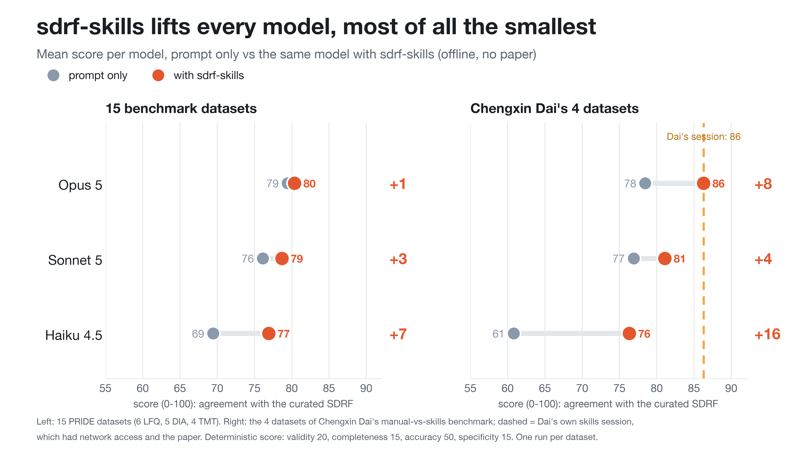

**sdrf-skills lifts every model, most of all the smallest.**

| model | 15 benchmark datasets | Dai's 4 datasets |
|---|---|---|
| Haiku 4.5 | +7 (69 → 77) | +16 (61 → 76) |
| Sonnet 5 | +3 (76 → 79) | +4 (77 → 81) |
| Opus 5 | +1 (79 → 80) | +8 (78 → 86) |

On Dai's datasets, offline Opus with skills matches Dai's own skills session (86), even though
that session had network access and the paper.

*Speaker note:* the gain is biggest where the model knows least. The skills carry the SDRF
knowledge, so a small model no longer has to recall it.

## 2. What it costs

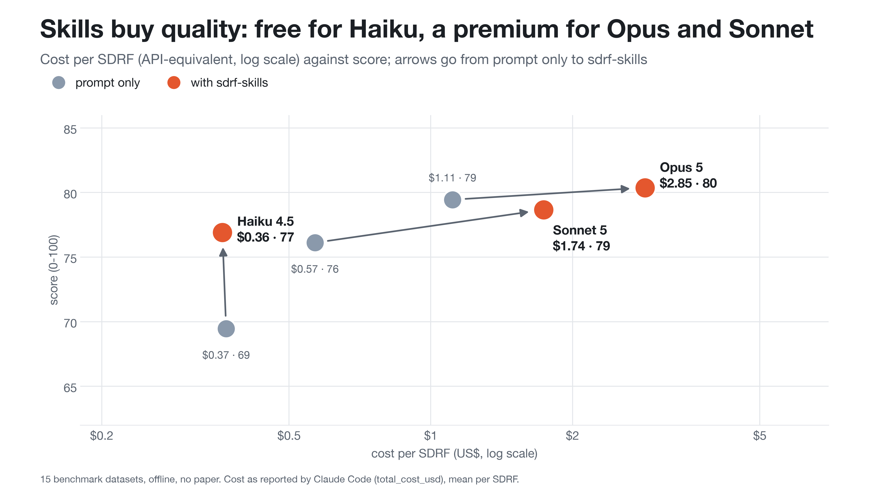

**Skills buy quality: free for Haiku, a premium for Opus and Sonnet.**

| model | score | cost per SDRF |
|---|---|---|
| Haiku 4.5, prompt only | 69 | $0.37 |
| **Haiku 4.5 + skills** | **77** | **$0.36** |
| Sonnet 5, prompt only | 76 | $0.57 |
| Sonnet 5 + skills | 79 | $1.74 |
| Opus 5, prompt only | 79 | $1.11 |
| Opus 5 + skills | 80 | $2.85 |

**Haiku 4.5 + skills is the value point:** Sonnet-level quality at a sixth of Opus's price.

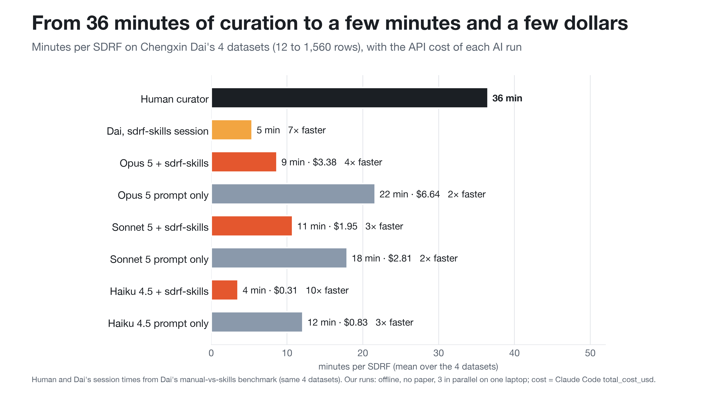

**From 36 minutes of curation to a few minutes and a few dollars.** On Chengxin Dai's four
datasets (12 to 1,560 rows):

| who | minutes per SDRF | cost per SDRF |
|---|---|---|
| **Human curator** | **36** (20–46) | — |
| Dai's own sdrf-skills session | 5 | — |
| Haiku 4.5 + skills | 4 | $0.31 |
| Opus 5 + skills | 9 | $3.38 |

That makes Haiku with skills about 10× faster than a curator, for about 30 cents.

*Speaker note:* our minutes are wall time with three runs in parallel on one laptop.

## 3. Quality of the models

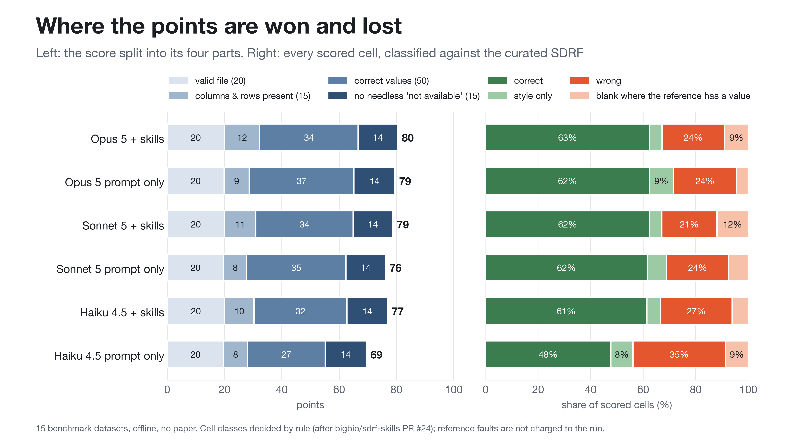

**Where the points are won and lost.**
- **Validity is solved:** every configuration earns the full 20 points.
- **The differences are in *correct values* (accuracy):** about 60% of scored cells match the
  curators and about a quarter are wrong, for every model with skills.
- **Prompt-only Haiku is the outlier:** 48% correct, 35% wrong.
- **The skills arm more often leaves a field blank than guesses it.** That costs coverage but not
  correctness.

## 4. sdrf-skills: what changed, and what to optimise next

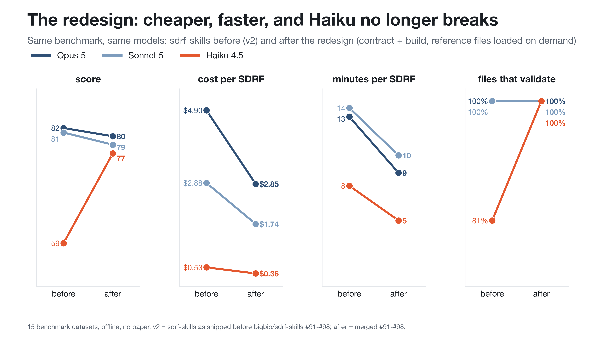

**The redesign: cheaper, faster, and Haiku no longer breaks.** Same 15 datasets, sdrf-skills
before (v2) and after (bigbio/sdrf-skills #91–#98):

| | Opus 5 | Sonnet 5 | Haiku 4.5 |
|---|---|---|---|
| cost per SDRF | $4.90 → $2.85 | $2.88 → $1.74 | $0.53 → $0.36 |
| minutes | 13 → 9 | 14 → 10 | 8 → 5 |
| score | 82 → 80 | 81 → 79 | **59 → 77** |
| files that validate | 100% → 100% | 100% → 100% | **81% → 100%** |

What produced it:

| change | what it does |
|---|---|
| **`contract`** | one call returns the exact column set, value forms and permissions of a template union, so the model stops reading templates |
| **`build`** | the model writes two small tables (samples and technical settings); `build` expands them into the SDRF deterministically, with row, fraction and channel logic, and refuses to guess a channel map |
| **One entry point** | `sdrf-annotate` with independent review always on; 10 skills consolidated into 4 |
| **Progressive disclosure** | a short core plus 17 reference files read on demand, so a SKILL.md no longer sits in every turn |
| **Tools callable in a locked-down sandbox** | a `sdrf-tools` console script; no plugin-root variable is needed |

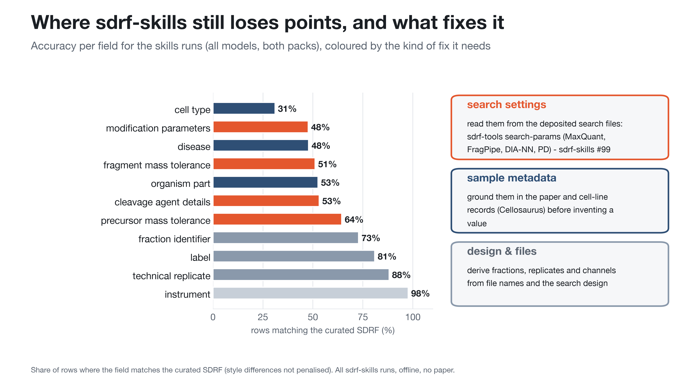

**Where sdrf-skills still loses points, and what fixes it.** Accuracy per field (skills runs):

| priority | idea | target | status |
|---|---|---|---|
| 1 | **Read search settings from the deposited search files, never from the paper.** Modifications, tolerances and cleavage agent are among the weakest fields (47–67%) yet are recorded verbatim in MaxQuant `mqpar.xml`/`summary.txt`, FragPipe `fragger.params`, DIA-NN logs and PD `.msf`. | `sdrf-tools search-params` | done: sdrf-skills #99. Next: fetch these small files into the benchmark evidence and measure the gain |
| 2 | **Ground sample metadata before writing it.** Cell type (35%), disease (46%) and organism part (50%) are the weakest fields, and the skills arm is *below* prompt-only on disease and organism part. Look up cell lines in Cellosaurus (disease, sex, age, cell type come with the record) and take tissue and disease from the paper's sample table. Prefer `not available` over a plausible guess. | sample metadata | next |
| 3 | **Classify the design first, then load its playbook.** TMT, SILAC, DIA, single-cell and immunopeptidomics each need different rows (channels, labels, windows, isolation). One short routing step would load only the matching reference. | design | idea |
| 4 | **Read remote `.msf`/`.pdResult` by byte range.** Proteome Discoverer results are multi-GB SQLite files; the search settings sit in one table. | `search-params` remote mode | idea |
| 5 | **Cache ontology lookups across runs.** A shared, offline cache of OLS terms would cut the most frequent tool calls and make runs reproducible. | cost | idea |
| 6 | **Check the reference before trusting a disagreement.** The benchmark found curated SDRFs that collapse TMT channels, use malformed accessions, pair `HCD` with the wrong accession (MS:1002481 instead of MS:1000422), or fail validation themselves. Feed these back to sdrf-annotated-datasets. | references | ongoing |
| 7 | **Issue every tool command on one line.** With the paper, one Haiku run wrote a correct `sdrf-tools build` call split with `\` line continuations; the sandbox refused it and the model stopped without an SDRF. One sentence in the skill ("tool commands on a single line; if a call is refused, retry it on one line") removes the failure. | robustness | next |

## 5. Experimental designs: difficulty and cost

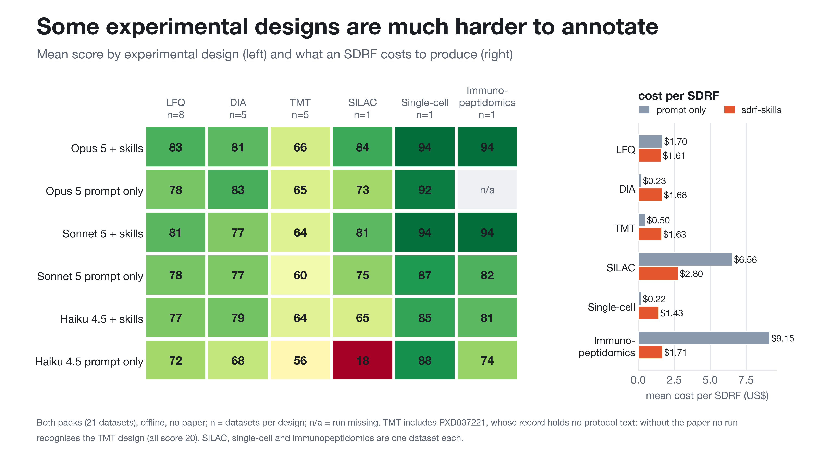

**Some experimental designs are much harder to annotate.**
- **Easy:**
  - Label-free and DIA land around 77–83 with skills.
  - Single-cell and immunopeptidomics score highest (85–94), but these are one dataset each,
    both with clear file naming.
- **Hard, TMT (64–65):**
  - A TMT SDRF has one row per channel, so the channel-to-sample map must be recovered.
  - One of the five TMT datasets (PXD037221) has no protocol text in its record, and no offline
    run recognises it as TMT. Without it, TMT is 75–77.
- **Hard, SILAC:** prompt-only Haiku collapses to 18; with skills it reaches 65.
- **Cost:** prompt-only cost explodes on SILAC ($6.56) and immunopeptidomics ($9.15), because
  there the model writes hundreds of rows. With skills the cost stays near $1.4–2.8 for every design.

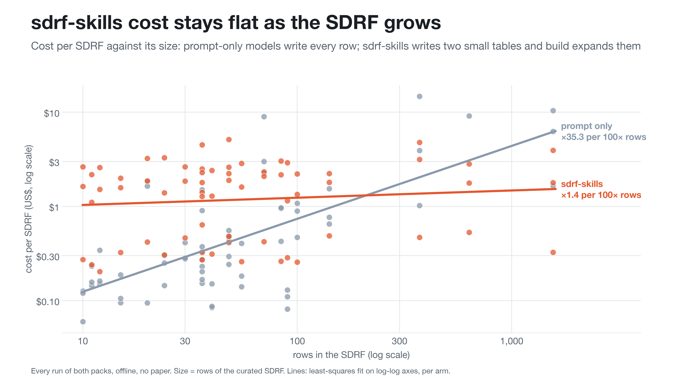

**sdrf-skills cost stays flat as the SDRF grows.**
- **Prompt-only:** the model writes every row, so cost grows about 36× for 100× more rows.
- **sdrf-skills:** the model writes two small tables and `build` expands them, so cost grows about
  1.5× for 100× more rows.
- **Crossover:** at about 200 rows, sdrf-skills becomes the cheaper option. Large studies (fractionated,
  multiplexed, many samples) are where the skills pay for themselves.

## 6. Does the paper help?

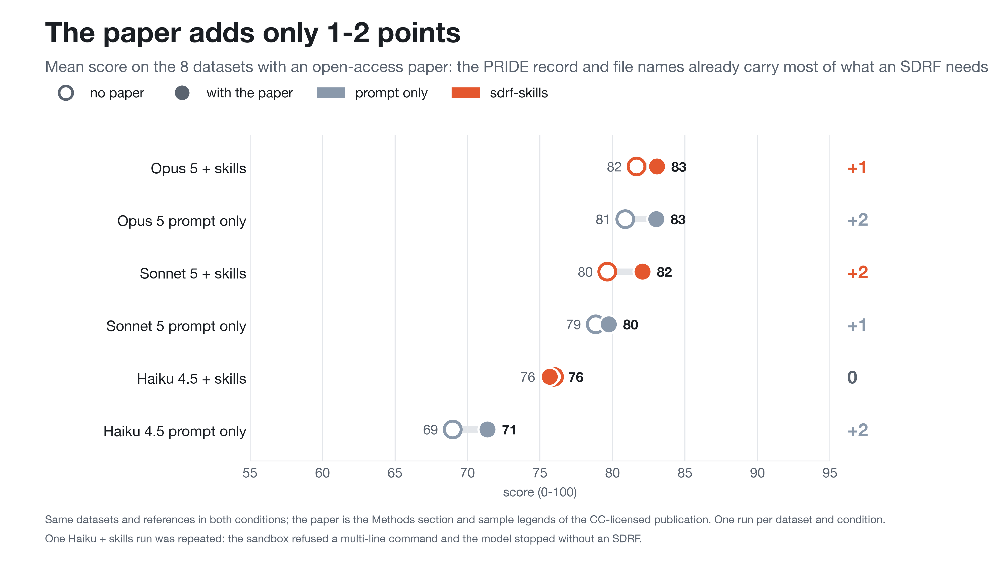

**The paper adds only 1–2 points.** The 8 benchmark datasets with an open-access paper were
annotated without and with the paper's Methods and sample legends:

| configuration | no paper | with paper | change |
|---|---|---|---|
| Opus 5 + skills | 82 | 83 | +1 |
| Opus 5, prompt only | 81 | 83 | +2 |
| Sonnet 5 + skills | 80 | 82 | +2 |
| Sonnet 5, prompt only | 79 | 80 | +1 |
| Haiku 4.5 + skills | 76 | 76 | 0 |
| Haiku 4.5, prompt only | 69 | 71 | +2 |

- **The paper matters less than expected.** The PRIDE record and the raw file names already carry
  most of what an SDRF needs; the paper sharpens sample metadata (disease, tissue) but doesn't
  change the design.
- **Skills matter more than the paper.** For Haiku, skills are worth +7 and the paper about 0.
- **The paper also costs more:** Opus + skills goes from $2.85 to $4.26 per SDRF, because it reads the
  extra text.
- *Speaker note:* one Haiku + skills run was repeated. The sandbox refused its multi-line command,
  and the model stopped without writing an SDRF (idea 7 above).

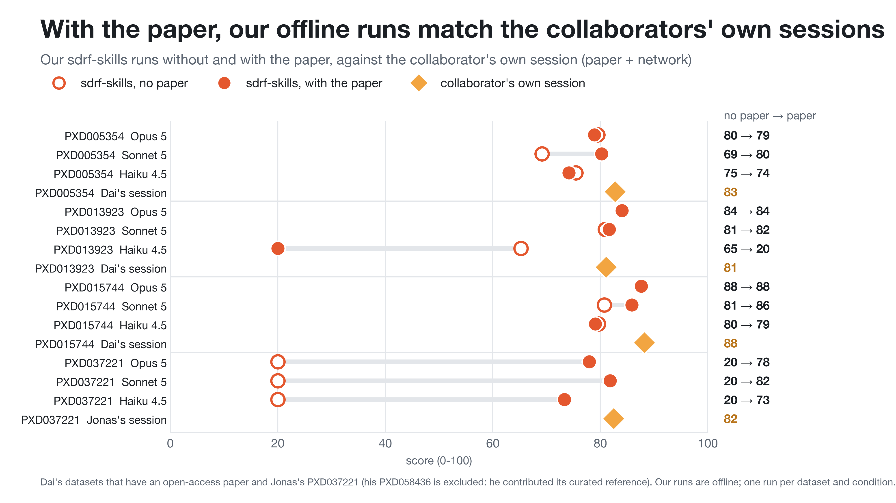

**With the paper, our offline runs match the collaborators' own sessions.** Dai and Jonas had the
paper and network access; here our sdrf-skills runs get the paper too (still offline).

| dataset | collaborator | Opus 5 + skills | Sonnet 5 + skills | Haiku 4.5 + skills |
|---|---|---|---|---|
| PXD005354 (1,560 rows) | Dai 83 | 80 → 79 | 69 → 80 | 75 → 74 |
| PXD013923 (SILAC) | Dai 81 | 84 → 84 | 81 → 82 | 65 → **20** |
| PXD015744 | Dai 88 | 88 → 88 | 81 → 86 | 80 → 79 |
| PXD037221 (TMT, iProX) | Jonas 82 | **20 → 78** | **20 → 82** | **20 → 73** |

(no paper → with the paper)

- **Parity with the collaborators.** With the paper, Opus and Sonnet land within about 3 points of
  the collaborators' own sessions.
- **The paper is decisive when the record is empty.** PXD037221's record has no protocol text, so
  no offline run recognises its TMT design (20). With the paper, every model does (73–82).
- **One Haiku regression.** On PXD013923, Haiku with the paper modelled the SILAC channels
  wrongly: a valid SDRF, but no row matches the reference. It is a real model error, kept as
  scored.
- *Speaker note:* one Haiku + skills run on PXD058436 was repeated because of the same sandbox
  refusal as on slide 9 (idea 7).

## 7. sdrf-skills on open models (Pablo Moreno)

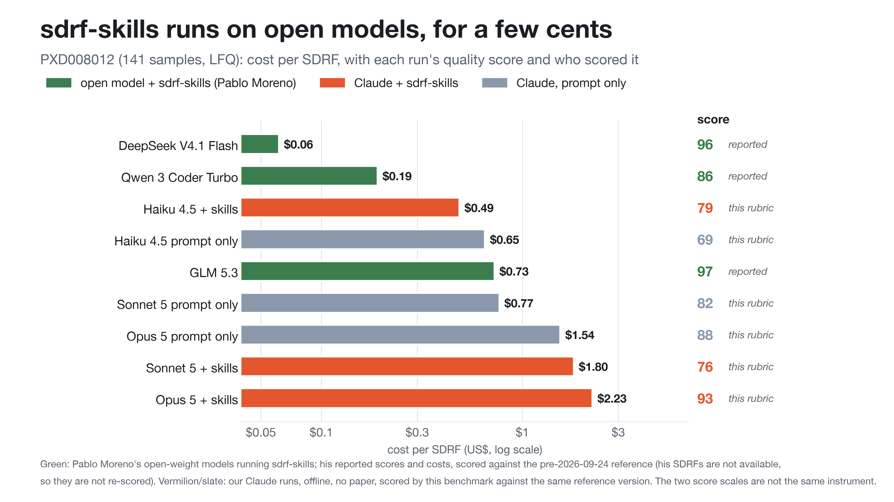

**sdrf-skills runs on open models, for a few cents.** Pablo Moreno ran three open-weight models
through the same sdrf-skills workflow (`samples.tsv` + `technical.tsv` → `sdrf-tools build`) on
PXD008012 (141 samples, label-free).

| model | cost per SDRF | score | scored by |
|---|---|---|---|
| DeepSeek V4.1 Flash + skills | **$0.06** | 96 | Pablo (reported) |
| Qwen 3 Coder Turbo + skills | $0.19 | 86 | Pablo (reported) |
| GLM 5.3 + skills | $0.73 | 97 | Pablo (reported) |
| Haiku 4.5 + skills | $0.49 | 79 | this benchmark |
| Opus 5 + skills | $2.23 | **93** | this benchmark |
| Opus 5, prompt only | $1.54 | 88 | this benchmark |

- **The workflow isn't tied to Claude.** Three open models completed it with no hallucinated terms.
  DeepSeek wrote a 143-row SDRF for six cents, 6× cheaper than our cheapest Claude configuration.
- **Two scales, never on one axis.** Pablo's files aren't available, so his scores are shown as
  he reported them. Both his runs and ours were measured against the same reference version
  (before the 2026-09-24 correction), but his scoring rubric isn't ours.
- **Opus 5 + skills tops our side (93).** On this one dataset Sonnet + skills (76) scored below
  Sonnet prompt-only (82): a single run, within run-to-run spread.
- **Reference sensitivity.** Against the corrected reference (fixed from the deposited searches),
  every one of our runs drops 2–4 points and the ranking holds. The correction fixed values that
  only the search files carry, which no offline run could see: another argument for
  `search-params` (idea 1).

---

**Regenerate:**

```bash
uv run sdrf-bench figures   # reads results/main, results/collaborators, results/history
```

**Caveats**
- **Agreement, not truth.** Scores measure agreement with one curated SDRF, not objective truth.
- **One replicate.** Differences of 1–2 points are within run-to-run spread.
- **Small design groups.** Design categories with one dataset are indicative only.
- **Timing and cost sources.** Times for the human curator and for Dai's session come from Dai's
  own measurements; costs are Claude Code's `total_cost_usd`.
